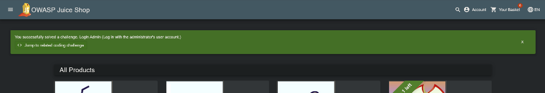
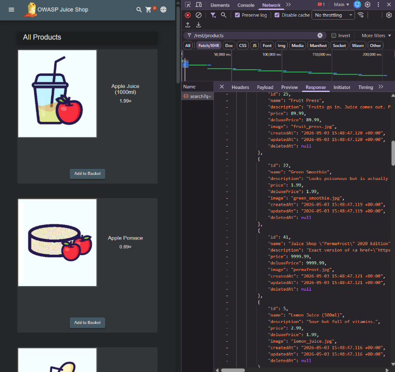
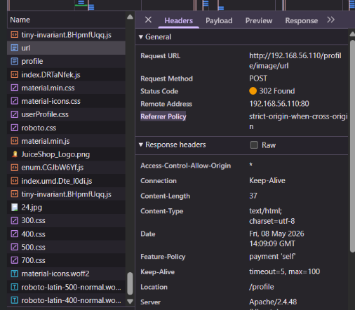

# OWASP Juice Shop — Web Application Security Assessment

> **Postgraduate portfolio case study | Controlled training lab | Assessment documented May 2026**
>
> Based on an original 58-page academic report, edited into a public-facing, evidence-led summary. This is **not** a claim of professional penetration-testing work.

## Overview

This case study examines five OWASP Top 10 (2021) risk areas using the deliberately vulnerable **OWASP Juice Shop** application in a local virtualised environment. The original work combined manual tests, browser developer tools, review of HTTP requests and responses, and analysis of security controls. The public version distinguishes **demonstrated results** from **observed behaviour** and **hypothetical risks**.

**Documents:** [Portfolio case study (PDF)](OWASP_Juice_Shop_Case_Study.pdf) · [Editable case study (DOCX)](OWASP_Juice_Shop_Case_Study.docx)

## Environment and methods

- **Target:** OWASP Juice Shop (intentionally vulnerable training application)
- **Lab:** Vagrant and VirtualBox; local web browser
- **Methods:** manual testing, browser developer tools / Network panel, inspection of forms, requests, responses, and application messages
- **Scope:** local lab only; no real-world target, organisational engagement or data exfiltration

## What I did

- Provisioned a local OWASP Juice Shop lab using Vagrant and VirtualBox.
- Executed manual login, registration and password-recovery exercises in the deliberately vulnerable application.
- Used the browser Network panel to inspect API calls, JSON content, response status codes and error disclosures.
- Evaluated the observations against the relevant security risks and proposed mitigations, identifying where the evidence did **not** establish an exploit.

These activities are based on the original May 2026 coursework; I did not repeat the tests for this portfolio adaptation.

## Results and evidence

| Risk area | Evidence assessment | Source-backed observation | Selected evidence |
|---|---|---|---|
| Injection (SQL) | **Demonstrated** | Login attempt using an SQL-style input; the application displayed a success banner for its `Login Admin` challenge. No database extraction is documented. | [Input](evidence/01_sql_injection_login_input.png), [Challenge completion](evidence/02_sql_injection_success_banner.png) |
| Broken Access Control | **Not established** | Authenticated `/rest/order-history` request captured in developer tools. No cross-account access or authorisation bypass demonstrated. | [Request inspection](evidence/03_order_history_devtools.png) |
| Security Misconfiguration | **Observed** | Product API response included `createdAt`, `updatedAt`, and `deletedAt` metadata; a verbose HTTP 500 response exposed Express details and stack information. | [JSON metadata](evidence/04_product_api_json_metadata.png), [Error response](evidence/05_verbose_express_error.png) |
| Identification and Authentication Failures | **Demonstrated in lab** | Original test notes record registration with `12345` and a security-question password reset to `123456`; screenshots support the registration workflow and successful reset. No account takeover demonstrated. | [Registration](evidence/06_weak_password_registration.png), [Password reset](evidence/07_password_reset_confirmation.png) |
| SSRF | **Not established** | User-controlled image URL was submitted, browser captured `POST /profile/image/url`, and the endpoint returned HTTP `302 Found`. This **does not establish that the server fetched the target** or accessed internal resources. | [Image URL](evidence/08_image_url_field.png), [POST and 302](evidence/09_profile_image_url_http_302.png) |

## Highlights

### SQL injection — login challenge
The report documents an injected login input followed by an OWASP Juice Shop **challenge-solved** banner. The result applies to the deliberately vulnerable training environment. Prepared statements / parameterised queries and least-privileged database accounts are central mitigations. Original report: **pp. 9–10, §2.3**.



### Authentication controls
The original exercise tested weak-password registration and security-question-based recovery. Its account creation and password reset demonstrate permissive controls for the tested lab account. Recommended controls include checking passwords against known weak values, safer recovery tokens, rate limiting, and appropriate MFA. Original report: **pp. 36–39, §5.3**.

### API and error-message inspection
The developer-tools captures show how client-visible JSON and error traces can reveal details of an application's implementation. The captured order-history request shows API interaction, but **does not prove an access-control vulnerability** without a second-identity or resource-ownership test. Original report: **pp. 17–18 (§3.3)** for access-control inspection; **p. 27 (§4.3)** for JSON and error disclosure.



### SSRF — evidence boundary
The image-URL submission produced an HTTP `302` response from `/profile/image/url`. That is evidence of input submission to an application endpoint, **not** evidence that Juice Shop initiated an outbound HTTP request to the target URL. Proving SSRF would require controlled server-side request logs or an observable callback target; that validation was not performed in the original submitted work. Original report: **pp. 48–49, §6.3**.



## Recommendations

1. Use parameterised queries and test authentication code paths against unsafe inputs.
2. Reject common passwords and strengthen account recovery verification.
3. Test object-level authorisation with distinct lab identities, rather than inferring it from a bearer token alone.
4. Minimise unnecessary API fields and suppress verbose error traces in production configurations.
5. Validate destinations for URL-fetching features and restrict network egress; perform further testing before labelling SSRF as confirmed.

## Evidence limitations and provenance

The screenshots are from the original academic assignment, not from a newly executed assessment. Some screenshots have been cropped and lab-only email/answer fields obscured to avoid publishing unnecessary account details. The PDF also uses tighter detail crops of these same anonymised screenshots to make the text more readable; no evidence has been reconstructed or substituted. The source document's relevant sections are **2.3, 3.3, 4.3, 5.3, and 6.3**. The full original academic report is intentionally **not included** in this public-ready repository. The author attribution is intentionally omitted here: add a preferred public name or GitHub handle only if desired.

**Source-page map:** SQL injection pp. 9–10; access control pp. 17–18; misconfiguration p. 27; authentication pp. 36–39; SSRF pp. 48–49 (all pages refer to the original 58-page assignment).

**Evidence terminology:** “Demonstrated” means a practical outcome is supported; “Observed” describes captured application behaviour; “Not established” means a vulnerability was not proved by the available evidence. No CVSS scores are assigned.

## Suggested repository layout

```text
owasp-juice-shop-security-assessment/
├── README.md
├── EVIDENCE_REVIEW.md
├── OWASP_Juice_Shop_Case_Study.pdf
├── OWASP_Juice_Shop_Case_Study.docx
└── evidence/
    ├── 01_sql_injection_login_input.png
    ├── 02_sql_injection_success_banner.png
    ├── 03_order_history_devtools.png
    ├── 04_product_api_json_metadata.png
    ├── 05_verbose_express_error.png
    ├── 06_weak_password_registration.png
    ├── 07_password_reset_confirmation.png
    ├── 08_image_url_field.png
    └── 09_profile_image_url_http_302.png
```

## References

- OWASP Top 10 (2021): <https://owasp.org/Top10/>
- OWASP Juice Shop project: <https://owasp.org/www-project-juice-shop/>

*Academic, controlled environment. No production systems tested. No professional penetration-testing experience claimed.*
